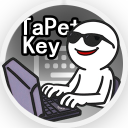
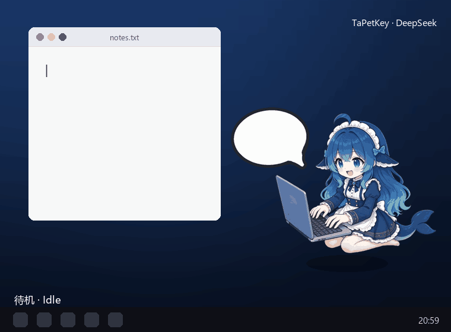
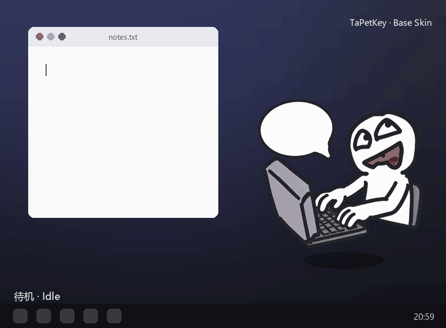
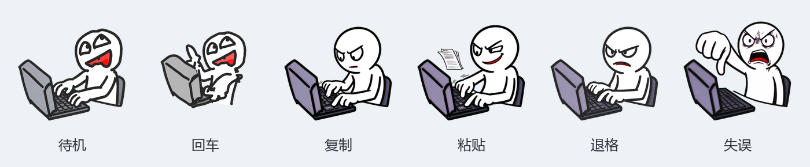
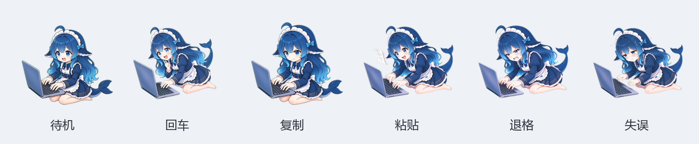
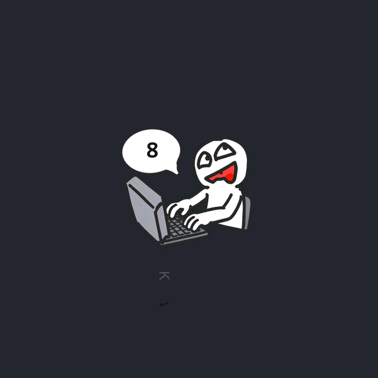
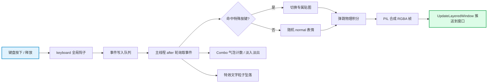

<p align="center">
  
</p>

<h1 align="center">TaPetKey</h1>

<p align="center">
  <b>会对你每一次敲击做出回应的桌面键盘桌宠</b>
</p>

<p align="center">
  <a href="https://github.com/f0lkskill/TaPetKey/releases"></a>
  
  
  
  <a href="https://github.com/f0lkskill/TaPetKey/stargazers"></a>
</p>

<p align="center">
  <a href="#-这是什么">这是什么</a> ·
  <a href="#-功能特性">功能特性</a> ·
  <a href="#-皮肤展示">皮肤展示</a> ·
  <a href="#-快速开始">快速开始</a> ·
  <a href="#-工作原理">工作原理</a> ·
  <a href="#-技术栈">技术栈</a> ·
  <a href="#-自定义皮肤">自定义皮肤</a> ·
  <a href="#-常见问题">常见问题</a>
</p>

<p align="center">
  
</p>

---

## 📖 这是什么

**TaPetKey** 是一个 Windows 桌面键盘反馈桌宠：一个**无边框、真透明**的 Q 版角色停在你的桌面上，你敲键盘它就有反应——按下时蹦一下、切换表情，连击时旁边冒出气泡计数，敲到特殊键还会甩出对应的文字特效。

它不是静态壁纸，而是一层**贴着桌面的实时动画**：角色贴着光标之外随意摆放，透明像素点击穿透，不挡你干活。

> [!NOTE]
> 窗口使用 **每像素 alpha 分层窗口**（不是色键抠图），所以抗锯齿边缘干净、完全透明的区域可以直接点穿到桌面。所有配置写在注册表 `HKCU\Software\TaPetKey`，卸载无残留。

## ✨ 功能特性

| | 能力 | 说明 |
|---|---|---|
| ⌨️ | **键盘反馈** | 全局监听按键，打字即反应，长按连发也不卡顿 |
| 🫧 | **Combo 气泡** | 连击实时计数、淡入淡出，失连击时触发「失误」动画 |
| ✨ | **按键特效** | 按键名以文字粒子旋转坠落，渐入渐出 |
| 🖼️ | **每像素透明** | Win32 分层窗口真透明，透明区点击穿透 |
| 🎨 | **皮肤系统** | 托盘一键换肤，皮肤自带缩放与偏移配置 |
| 🧲 | **弹跳物理** | 按键触发基于重力积分的弹跳动画 |
| 🔍 | **无级缩放** | 50% ~ 200% 整体缩放，气泡与特效同步 |
| 🧩 | **特殊按键贴图** | `Enter` / `Space` / `Tab` / `Backspace` / `Ctrl+C` / `Ctrl+V` 等专属表情 |
| 🚀 | **开机自启** | 一键写入注册表自启动项 |
| 📌 | **位置记忆** | 拖拽摆放，退出后记住皮肤、缩放与坐标 |
| 🧷 | **系统托盘** | 原生自绘菜单，皮肤子菜单带预览缩略图 |

## 🐾 皮肤展示

内置两款风格完全不同的皮肤，切换后角色的**待机、回车、复制、粘贴、退格、失误**姿态全部替换。

### 🅰️ Base Skin

黑白火柴人风格，一本正经地敲键盘：待机时呆萌、复制粘贴时一脸坏笑、退格时皱眉、失误时抓狂。

<p align="center">
  
</p>

<p align="center"><sub>Base Skin 实机演示 · 依次展示待机 → 回车 → 空格 → Tab → 退格 → 复制 → 粘贴 → 6 → 7 → 失误</sub></p>

<p align="center">
  
</p>

### 🅱️ DeepSeek Skin

深蓝鲸鱼娘主题，柔和渐变立绘，趴在笔记本前陪你敲字。

<p align="center">
  
</p>

<p align="center"><sub>DeepSeek Skin 实机演示 · 同样的全套特殊按键流程</sub></p>

<p align="center">
  
</p>

按键特效文字效果（角色附近的旋转坠落文字）：

<p align="center">
  
</p>

## 🚀 快速开始

1. 下载或克隆本仓库。
2. 安装依赖并运行：

```powershell
git clone https://github.com/f0lkskill/TaPetKey.git
cd TaPetKey
python -m venv .venv
.venv\Scripts\activate
pip install -r requirements.txt
python main.py
```

> [!TIP]
> 依赖只有 `keyboard`、`pillow`、`pywin32`、`loguru` 等常见库，见 [`requirements.txt`](requirements.txt)。

**使用方式**

- **左键拖拽**：把桌宠拖到任意位置（退出后自动记住）。
- **右键托盘图标 → 皮肤**：切换皮肤（子菜单带预览图）。
- **右键托盘 → 放大 / 缩小**：50% ~ 200% 无级缩放。
- **右键托盘 → 开机自启动**：一键开关。
- **右键托盘 → 退出**：保存状态并退出。

## ⚙️ 工作原理

按下键盘后，事件经过一条固定流水线变成屏幕上的动画：



- **跨线程安全**：键盘钩子只往队列里塞事件，所有 tkinter 操作都回到主线程 `after` 轮询里执行，避免子线程触碰 UI 导致闪烁或崩溃。
- **真透明**：窗口被改造为 `WS_EX_LAYERED` 分层窗口，用 `UpdateLayeredWindow` 直接推 PIL 的 RGBA 图，彻底避开色键的锯齿与误扣问题。
- **状态持久化**：皮肤、缩放、坐标写入注册表，即使进程被强杀也能记住。

## 🧰 技术栈

| 层 | 技术 |
|---|---|
| **语言** | Python 3.14 |
| **界面** | tkinter（原生，无第三方 GUI 框架） |
| **图像合成** | Pillow（角色缩放、特效粒子、气泡渲染） |
| **透明窗口** | Win32 分层窗口（`ctypes` 调用 `user32` / `gdi32` + `UpdateLayeredWindow`） |
| **键盘监听** | `keyboard`（全局钩子与组合热键） |
| **系统托盘** | `pywin32`（`win32gui` / `win32api`）+ `ctypes` owner-draw 自绘菜单 |
| **主题适配** | `uxtheme.dll` 读取系统菜单配色，自动跟随浅色 / 深色主题 |
| **配置持久化** | Windows 注册表（`winreg`，`HKCU\Software\TaPetKey`） |
| **日志** | `loguru`（输出到 `app.log`） |
| **目标平台** | Windows 10 / 11 |

## 📁 项目结构

```
TaPetKey/
├─ main.py                    # 入口：主窗口、事件轮询、弹跳物理、缩放与换肤
├─ requirements.txt           # 运行依赖
├─ modules/
│  ├─ config/                 # 注册表配置读写、开机自启动
│  ├─ keyborad/               # 全局键盘监听与热键（trigger.py）
│  ├─ log/                    # loguru 日志封装
│  ├─ skin_loader/            # 皮肤扫描、info.json 解析、素材加载
│  ├─ widgets/
│  │  ├─ charactor.py         #   角色 Canvas（切换 / 随机 / 缩放）
│  │  └─ tray.py              #   原生系统托盘 + owner-draw 自绘菜单
│  └─ window/
│     ├─ layered.py           #   每像素 alpha 分层窗口封装
│     ├─ count.py             #   Combo 计数气泡窗口
│     └─ effect.py            #   按键特效文字粒子窗口
├─ assets/
│  ├─ icon/                   # 托盘与菜单图标
│  ├─ skins/                  # 皮肤素材（base / deepseek）
│  ├─ ui/                     # Combo 气泡底图
│  └─ previews/               # README 展示图与演示 GIF
├─ tools/
│  └─ make_preview_gif.py     # 生成皮肤演示 GIF 的脚本
└─ test/                      # 测试脚本
```

## 🎨 自定义皮肤

皮肤就是 `assets/skins/<皮肤ID>/` 下的一个文件夹，放素材 PNG 和一个 `info.json`。复制现有皮肤改素材即可。

**素材命名约定**

| 文件名 | 含义 |
|---|---|
| `normal_1.png` … `normal_N.png` | 待机 / 普通打字表情，随机轮换 |
| `key_enter.png`、`key_space.png`、`key_tab.png`、`key_backspace.png`、`key_6.png` … | 单个特殊按键的专属贴图 |
| `key_ctrl+c.png`、`key_ctrl+v.png` | 组合键贴图（文件名含 `+` 即视为组合热键） |
| `miss_1.png` … `miss_N.png` | 连击中断（失误）动画 |

**`info.json` 字段**

| 字段 | 说明 |
|---|---|
| `name` | 皮肤显示名 |
| `description` | 皮肤描述 |
| `version` | 版本号 |
| `author` | 作者 |
| `icon` | 托盘 / 子菜单预览图（相对皮肤目录） |
| `scale` | 角色基准缩放（默认 `0.5`） |
| `combo_offset` | Combo 气泡相对窗口左上角的偏移 `[x, y]` |
| `effect_offset` | 特效文字相对窗口中心的偏移 `[x, y]` |

改完把文件夹丢进 `assets/skins/`，重启后右键托盘 → 皮肤 即可看到。

## ❓ 常见问题

**透明的地方点不到，会不会挡住操作？**
不会。分层窗口完全透明的像素自动点击穿透；只有角色本体所在区域会接收拖拽。

**托盘图标 / 键盘事件没有反应？**
`keyboard` 使用全局键盘钩子，部分安全软件会拦截。请把程序加入杀软白名单；若仍收不到按键，可尝试以管理员身份运行。

**程序启动后看不到角色？**
角色会出现在上次退出的位置；如果拖到了屏幕外，删除注册表 `HKCU\Software\TaPetKey` 下的 `win_x` / `win_y` 即可复位。

**它记录我打了什么字吗？**
不会。程序只读取按键的“名字”来驱动动画，不保存、不联网、不上传任何输入内容。

**配置存在哪里？**
全部在注册表 `HKCU\Software\TaPetKey`（皮肤、缩放、坐标、自启动）。日志在程序目录的 `app.log`。

**想换更大 / 更小的桌宠？**
右键托盘 → 放大 / 缩小，或调整皮肤 `info.json` 里的 `scale`。

## 📜 免责声明

1. **软件性质**：本项目开源免费，仅供学习、研究与个人使用。
2. **输入隐私**：程序监听全局键盘事件，但**不记录、不存储、不上传**任何按键内容，仅用于驱动画面动画。
3. **风险自担**：在特定环境（如受管控设备）使用全局键盘钩子可能触发安全软件告警，请自行评估并确认合规使用。
4. **素材版权**：仓库内皮肤素材版权归原作者所有，请勿用于商业用途。

## 📄 许可证

本项目基于 **[MIT 许可证](LICENSE)** 分发，© 2026 f0lkskill。

---

<p align="center"><i>Built with ❤️ for people who like typing with a little buddy.</i></p>
